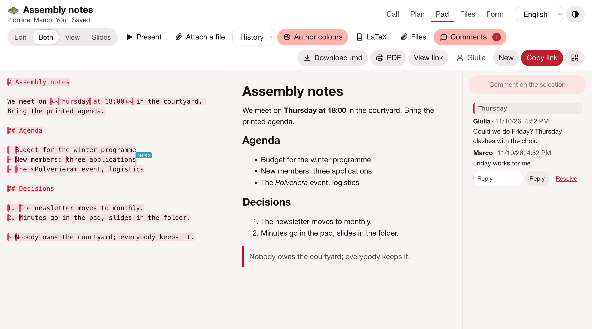

<p align="center"></p>

# Chiostro

End-to-end encrypted, anonymous collaboration suite. Live at [chiost.ro](https://chiost.ro).

[](https://github.com/lsd-cat/chiostro/actions/workflows/test.yml)

<p align="center"></p>

## Tools

- **Call**: video calls with chat, screen and PDF sharing, annotations and polls.
- **Plan**: find a time that works for everyone.
- **Pad**: write together, with slides, comments, attachments and PDF export.
- **Files**: file sharing and collection.
- **Form**: collect information, answers and surveys, privately or publicly.

A link opens a meeting with all five. Each tool has its own link, and pads and files have a
read-only link as well.

## How it works

- Content is encrypted in the browser with keys derived from the link. The server sees room ids,
  sizes, timing and addresses.
- The backend is a few hundred lines of Lua on OpenResty: a WebSocket relay that forwards sealed
  messages and a write-once store of sealed blobs.
- The store keeps blobs on disk, or entirely in an S3-compatible bucket. In bucket mode the host
  holds nothing but the upload spool, and a restore is a new host plus the deploy role.
- The client is a static bundle with no runtime dependencies and a Content Security Policy
  without inline script or style, so it can be signed for WEBCAT. Per-deployment settings are data
  in `config.json`.
- Rooms expire after a configured number of days without a write. No accounts, no admin.

The details, including the key schedule and the trust model, are in [docs/design.md](docs/design.md).

## Run

```sh
npm install && npm run build
mkdir -p openresty/data/{tmp,meet,p2p,when,pad,share,form}
openresty -p openresty -c nginx.conf        # http://127.0.0.1:8080
npm test                                    # unit tests, relay protocol in both store modes
npm run e2e                                 # every tool in headless Chrome
```

`config.json` in the repository root overrides `config.example.json`. PDF export needs the TeX
bundle from the [tstex](https://github.com/lsd-cat/tstex) repository:

```sh
git clone --depth 1 https://github.com/lsd-cat/tstex deploy/.cache/tstex
ln -s ../deploy/.cache/tstex/bundles/minimal openresty/texmf
```

## Deploy

`deploy/roles/chiostro` is an Ansible role for a Debian host. It installs nginx with its Lua
module, acme.sh and coturn in STUN-only mode, fetches the TeX bundle, and renders the vhost. Set
`chiostro_domain`, `chiostro_config` and, for a bucket, `chiostro_store: s3` with `chiostro_s3`;
the full TeX bundle can be served from the bucket too (`chiostro_texmf_object_prefix`).
`deploy/site.yml` is the playbook for chiost.ro, with its secrets in a gitignored
`deploy/secrets.yml`. Translations live in `web/src/core/lang/`, one file per language.

The planner's grid logic is ported from crab.fit (GPL-3.0).
